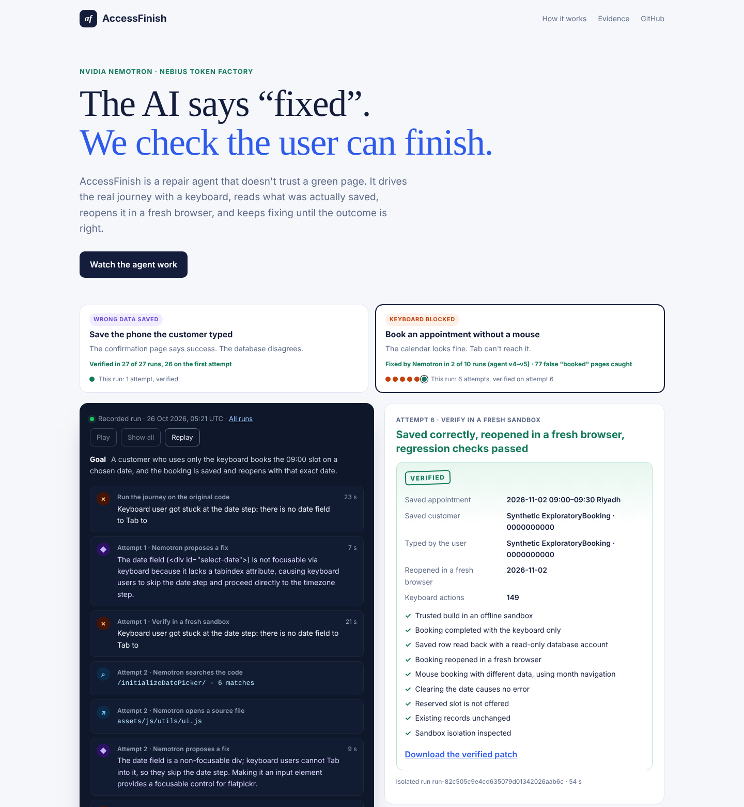

# AccessFinish

**The AI says "fixed". AccessFinish checks the user can finish.**

AccessFinish is a repair agent built on **NVIDIA Nemotron 3 Super** (served by **Nebius Token Factory**). It doesn't trust a green confirmation page. It drives the real user journey with a keyboard, reads what was actually saved in the database, reopens it in a fresh browser — and keeps repairing until that outcome is correct.

▶ **Live page:** https://sultalfaifi.com/accessfinish/ · Track: **Coding and Agentic Engineering**



## The loop

```
Observe ──► Diagnose & repair ──► Verify for real ──► verified? ── yes ──► patch + proof
   ▲              (Nemotron)        (fresh sandbox)        │
   └──────────── verifier evidence fed back ◄──── no ──────┘
```

1. **Observe.** A headless browser books an appointment with the keyboard only, recording where focus goes and where it gets stuck.
2. **Diagnose & repair.** Nemotron receives the user goal, the verifier's evidence and the complete source files — no diagnosis, no hints — and returns exact code edits.
3. **Verify for real.** Every proposal is built and run in a fresh, offline Docker sandbox. The verifier books with the keyboard, reads the saved row through a read-only database account, reopens the booking in a new browser, then runs regression checks (a mouse booking with different data through month navigation, clearing the date, a reserved slot, unchanged existing records, sandbox isolation).
4. **Feed back.** A build error, a stuck key, a wrong saved value or a broken mouse path goes back to Nemotron as evidence, and it tries again (up to four attempts). Nothing is accepted unless every check passes.

## Two broken journeys

| Journey | What the user sees | What's really wrong |
| --- | --- | --- |
| **Keyboard date** (real upstream bug) | The calendar looks fine | Tab can't reach it, so a keyboard user can never book |
| **Saved phone** (seeded fault) | "Booking confirmed" | The database stored `0000000000`, not the phone they typed |

The phone case shows why outcome checks matter: a patch that hardcodes the sample number passes once, then fails when a second customer types `0000000073`.

## Run it

Requires **Node.js 22+** and **Docker** (Linux engine). No npm dependencies on the host.

```sh
npm run demo:setup                     # build the pinned sandbox images (several GB, once)
export NEBIUS_API_KEY=...              # your Token Factory key
node scripts/agent.cjs --case keyboard-date
node scripts/agent.cjs --case customer-phone
```

Or start the page with `npm start`, open http://127.0.0.1:4177 and press **Run live**. Without a key, `npm run replay` serves the recorded runs at http://127.0.0.1:4178.

`--publish` saves a finished run (trace, verified patch and evidence) to `web/agent-runs/` and `evidence/agent-runs/`.

## Under the hood

- **Model:** `nvidia/nemotron-3-super-120b-a12b` via `https://api.tokenfactory.nebius.com/v1/chat/completions`, with a forced `propose_repair` tool call. Edits must match the original source exactly once, or they are rejected before anything runs. Each request's tokens and cost are recorded.
- **Sandbox:** separate containers for the app, database, compiler, browser and verifier; no network, no model key, read-only roots, all capabilities dropped, CPU/memory/PID limits. Model output never becomes a shell command.
- **App:** a pinned copy of the open-source [Easy!Appointments](https://github.com/alextselegidis/easyappointments) (GPL-3.0) with synthetic data.
- **Code:** `lib/agent.cjs` (the loop), `lib/fixture.cjs` (sandbox and verifier), `integration/portable/` (browser workers and outcome evaluator), `web/` (the page).

```sh
npm test                      # unit tests, including the agent loop
npm run check:records         # earlier recorded evaluation is intact
```

## Earlier evidence

Before the agent, we measured single-shot, operator-guided repairs: on 21 October five frozen Nemotron requests on the keyboard case gave **2/5** full passes (two compile errors, one broken calendar navigation). Those failures are exactly what the agent's feedback loop now recovers from. All raw requests, responses and executions are kept in [`evidence/`](evidence/) and browsable on the [evidence page](web/workbench.html).

## Limits

Two journeys in one application; the phone fault was seeded on purpose. The data is synthetic. This is not a screen-reader user study.

## License

AccessFinish is MIT licensed. The bundled Easy!Appointments source and patches to it remain GPL-3.0 — see [THIRD_PARTY_NOTICES.md](THIRD_PARTY_NOTICES.md).
