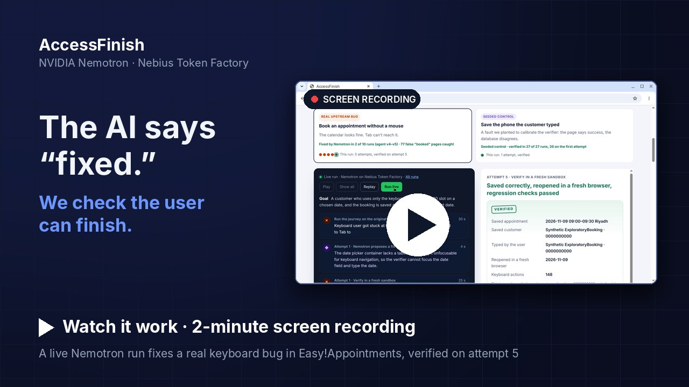
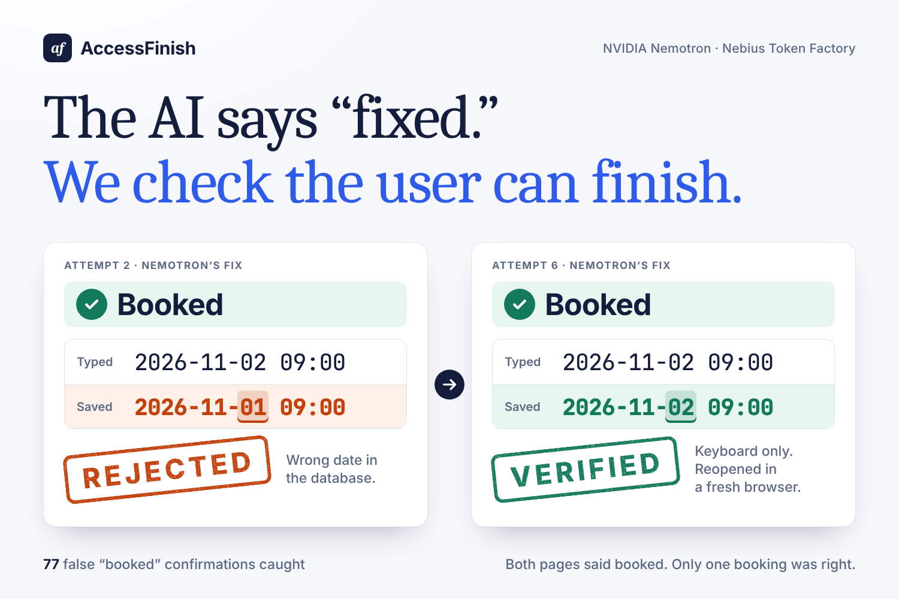
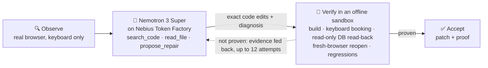
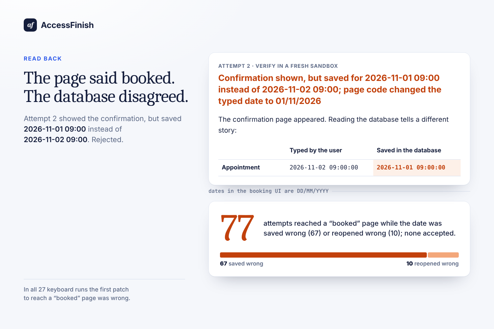
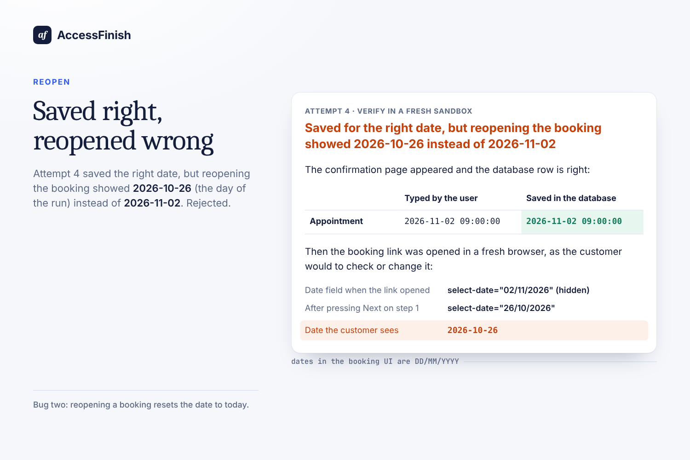
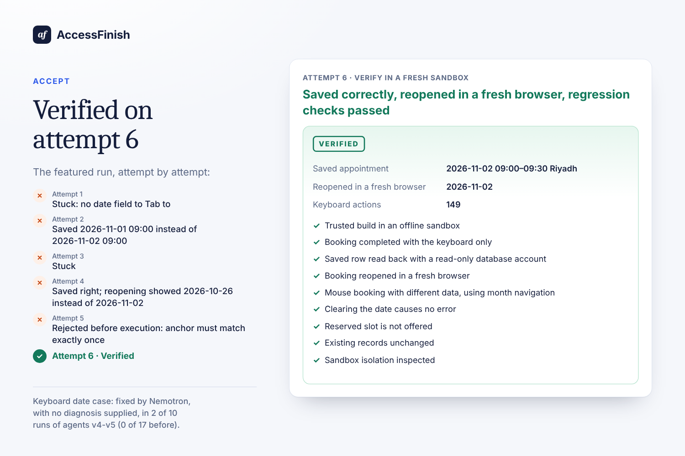
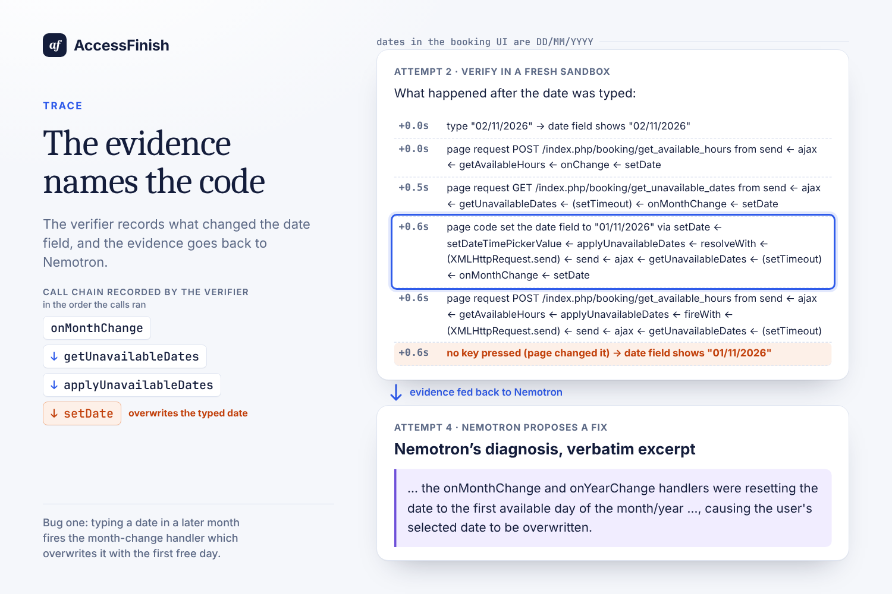

<div align="center">

# AccessFinish

<p><b><big>The AI says “fixed.” We check the user can finish.</big></b></p>

A repair agent on **NVIDIA Nemotron 3 Super** (served by **Nebius Token Factory**) that accepts a fix only when a keyboard-only browser session (real keystrokes in a real browser) can finish the task, the database holds what was typed, and a fresh browser shows it back.

[](https://youtu.be/ZHSP0GYMM20)
[](https://sultalfaifi.com/accessfinish/)
[](https://sultalfaifi.com/accessfinish/evidence.html)

[](https://github.com/SultanAlfaifi/accessfinish/actions/workflows/clean-execution.yml)


[](LICENSE)

<a href="https://youtu.be/ZHSP0GYMM20"></a>
<br><sub>No YouTube? <a href="media/accessfinish-agent-demo.mp4">Watch the MP4 in the repository (20 MB)</a></sub>

| **0 / 77** | **2 / 10** | **27 / 27** | **$6.38** |
| :---: | :---: | :---: | :---: |
| false “booked” fixes accepted: 67 saved the wrong date, 10 reopened wrong. In **27 of 27** keyboard runs the first “booked” patch was wrong | runs of agents v4–v5 where Nemotron fixed a **real upstream keyboard bug**, no root cause supplied (2 of 27 keyboard runs overall) | runs verified on a **seeded** phone fault, our calibration control, 26 on the first attempt | estimated Nemotron cost for all **54 live runs** at list price: about **$1.70** per verified keyboard fix in agents v4–v5 |

</div>

## The problem

Ask an AI to fix a broken form and it will tell you it's fixed. The page loads, a confirmation appears, the build is green. But a keyboard user still can't reach the date picker, or the booking is saved for the wrong day. For people who rely on a keyboard or assistive technology, *it renders* is not the same as *I can finish*.

In our runs this happened **77 times**: Nemotron's patch reached a “booked” page while the date was saved or reopened wrong. In **all 27** keyboard runs, the first patch that reached a “booked” page was wrong. A check that trusts the confirmation page would have shipped a broken fix every time.

This matters at scale. About **1.3 billion people (16%)** live with a significant disability ([WHO](https://www.who.int/news-room/fact-sheets/detail/disability-and-health)), **95.9%** of the top million home pages have detectable WCAG failures ([WebAIM Million 2026](https://webaim.org/projects/million/)), and since **28 June 2025** the [European Accessibility Act](https://eur-lex.europa.eu/eli/dir/2019/882/oj) requires in-scope services such as e-commerce to be accessible. Meanwhile coding agents write a growing share of UI fixes, judged by green builds and success pages: exactly the signals that can lie.

### What existing checks would have said about attempt 2's patch

| Check | What it looks at | Verdict on a patch that saves 1 Nov instead of 2 Nov |
| --- | --- | --- |
| axe / Lighthouse | Accessibility rules on one rendered page state: roles, labels, contrast | Out of scope: the wrong date only appears after typing, submitting and reading the database |
| The app's own tests | The pinned Easy!Appointments source ships two PHP unit-test files (array and validation helpers); none exercises the booking page | ✅ Pass: no test touches `booking.js` or the booking view |
| A test or LLM judge that reads the confirmation page | The page after submitting | ✅ “booked”: it passes. In all 27 keyboard runs, the first patch to reach that page was wrong |
| **AccessFinish** | The saved row (read-only database account) and the booking reopened in a fresh browser | ❌ **Rejected**: saved 1 Nov instead of 2 Nov, with the call chain of the code that changed the typed date |

<p align="center"></p>

## How it works



1. **Observe.** A headless browser books an appointment with the keyboard only, recording where focus goes, where it gets stuck, and which page code changes what the user typed.
2. **Diagnose & repair.** Nemotron gets the goal, the verifier's evidence and the source files, but **no root cause and no fix** (the acceptance checks do name the date field and how the verifier types into it). It investigates with read-only `search_code` and `read_file`, then returns exact code edits plus the evidence its diagnosis explains.
3. **Verify for real.** Each candidate is built and run in a fresh, offline Docker sandbox: keyboard booking, the saved row read back through a read-only database account, the booking reopened in a fresh browser, and regression checks (a mouse booking with different data through month navigation, clearing the date, a reserved slot, unchanged records, sandbox isolation).
4. **Feed back.** A compile error with its code frame, a stuck key, a wrong saved value, or the call chain that silently overwrote the date goes back to Nemotron, along with a ledger of every earlier attempt and which one got furthest. **Nothing is accepted unless every check passes.**

## Watch Nemotron fix a real bug

The keyboard case is real upstream code: the open-source [Easy!Appointments](https://github.com/alextselegidis/easyappointments), pinned at commit [`4bc7ecd`](https://github.com/alextselegidis/easyappointments/tree/4bc7ecd51f3dade8e041558f2c23dda65bd6c43e) with no defects injected ([`source-lock.json`](integration/portable/source-lock.json)). The date can't be reached by keyboard, and once it can, two more bugs lose it: the month-change handler overwrites a typed date with the first free day, and reopening a booking resets it to today. In live run [`2c87e16a`](evidence/agent-runs/agent-2c87e16a520f678b45cbbbeb.json) (agent v4), Nemotron fixed all of it:

| Attempt | What Nemotron did | What the verifier found |
| :---: | --- | --- |
| 1 | Added a `tabindex` to the date `<div>` | ❌ Keyboard user still stuck: no date field to Tab to |
| 2 | Turned the date `<div>` into a focusable `<input>` | ❌ Page said *booked*, database saved **1 Nov instead of 2 Nov** |
| 3 | Stopped the month-change handler resetting the date, but started over without attempt 2's fix | ❌ Stuck again |
| 4 | Built on attempt 2: the focusable input **plus** the month-change guard | ❌ Saved right, but **reopening showed today** (26 Oct) |
| 5 | Built on attempt 4: stop **Next** resetting the date to today | ❌ Rejected before execution: an edit didn't match the file exactly once |
| 6 | The same fix on attempt 4, with edits that applied | ✅ **Verified**: keyboard, database, fresh-browser reopen, regressions |

<table>
  <tr>
    <td width="33%"><br><sub><b>Attempt 2:</b> the page said booked; the database saved 1 Nov</sub></td>
    <td width="33%"><br><sub><b>Attempt 4:</b> saved right, reopened as today</sub></td>
    <td width="33%"><br><sub><b>Attempt 6:</b> verified, every check listed</sub></td>
  </tr>
</table>

The turning point was **agent v2**, which gave Nemotron *causal evidence*. The verifier hooks the date field's value setter and records DevTools async stacks, so the evidence names the exact code that overwrote what the user typed: `setDate ← applyUnavailableDates ← getUnavailableDates ← onMonthChange`. In v1, no diagnosis named the month-change handler (0 of 43), and 11 blamed time zones. In v2, which added this evidence together with code search, an attempt ledger and sampling at temperature 0.6, 20 of 39 named it.

<p align="center"></p>

Nemotron's final edits touch the same code sites as our earlier guided reference fix, but with guard logic of its own. The second verified run, [`2367fdf7`](evidence/agent-runs/agent-2367fdf762b0a63d26ee048b.json) (v5), got there on attempt 11. **Replay any run step by step on the [live page](https://sultalfaifi.com/accessfinish/?case=keyboard-date&run=agent-2c87e16a520f678b45cbbbeb#agent).**

<details>
<summary><b>The patch Nemotron wrote (run 2c87e16a, attempt 6, verified)</b></summary>

Copied verbatim from `accepted.patch` in [the trace](evidence/agent-runs/agent-2c87e16a520f678b45cbbbeb.json).

```diff
diff --git a/assets/js/pages/booking.js b/assets/js/pages/booking.js
index 36697fc..c33b9dd 100644
--- a/assets/js/pages/booking.js
+++ b/assets/js/pages/booking.js
@@ -132,6 +132,11 @@ App.Pages.Booking = (function () {
                             '-01',
                     );
 
+                    // Skip if the month has not changed
+                    if (previousMoment.month() === displayedMonthMoment.month() && previousMoment.year() === displayedMonthMoment.year()) {
+                        return;
+                    }
+
                     const monthChangeStep = detectDatepickerMonthChangeStep(previousMoment, displayedMonthMoment);
 
                     App.Http.Booking.getUnavailableDates(
@@ -154,6 +159,11 @@ App.Pages.Booking = (function () {
                             '-01',
                     );
 
+                    // Skip if the month has not changed
+                    if (previousMoment.month() === displayedMonthMoment.month() && previousMoment.year() === displayedMonthMoment.year()) {
+                        return;
+                    }
+
                     const monthChangeStep = detectDatepickerMonthChangeStep(previousMoment, displayedMonthMoment);
 
                     App.Http.Booking.getUnavailableDates(
@@ -423,15 +433,22 @@ App.Pages.Booking = (function () {
 
             // If we are on the first step, fetch unavailable dates and available hours for step 2.
             if ($target.attr('data-step_index') === '1') {
-                const todayMoment = moment();
-
-                App.Utils.UI.setDateTimePickerValue($selectDate, todayMoment.toDate());
-
-                App.Http.Booking.getUnavailableDates(
-                    $selectProvider.val(),
-                    $selectService.val(),
-                    todayMoment.format('YYYY-MM-DD'),
-                );
+                const selectedDate = App.Utils.UI.getDateTimePickerValue($selectDate);
+                if (!selectedDate) {
+                    const todayMoment = moment();
+                    App.Utils.UI.setDateTimePickerValue($selectDate, todayMoment.toDate());
+                    App.Http.Booking.getUnavailableDates(
+                        $selectProvider.val(),
+                        $selectService.val(),
+                        todayMoment.format('YYYY-MM-DD'),
+                    );
+                } else {
+                    App.Http.Booking.getUnavailableDates(
+                        $selectProvider.val(),
+                        $selectService.val(),
+                        moment(selectedDate).format('YYYY-MM-DD'),
+                    );
+                }
             }
 
             // If we are on the 2nd tab then the user should have an appointment hour selected.
diff --git a/application/views/components/booking_time_step.php b/application/views/components/booking_time_step.php
index 617dc3a..8eff1a6 100644
--- a/application/views/components/booking_time_step.php
+++ b/application/views/components/booking_time_step.php
@@ -13,7 +13,7 @@
 
         <div class="row frame-content">
             <div class="col-12 col-lg-6">
-                <div id="select-date" class="mx-auto my-4"></div>
+                <input type="text" id="select-date" class="mx-auto my-4" />
 
             </div>
 
```
</details>

## Results

All **54 runs** were made live on [fresh GitHub Actions runners](https://github.com/SultanAlfaifi/accessfinish/actions/workflows/agent-run.yml) with Nemotron 3 Super on Nebius Token Factory, **$6.38 in total**. After each batch we read the failed traces, improved the loop and bumped the agent version. From v2 on, results are never mixed across versions.

| Agent | What changed | Keyboard: saved correctly | Keyboard: **verified** | Phone: verified (1st attempt) |
| --- | --- | :---: | :---: | :---: |
| v1 | observe → propose → verify → feed back; attempt budget raised 4 → 6 → 8 during the batch (one run ended on a Token Factory 503 after 3 attempts) | 0 / 7 | 0 / 7 | 7 / 7 (7) |
| v2 | `search_code`, call-chain provenance of the date field, attempt ledger, reopen evidence | 1 / 5 | 0 / 5 | 5 / 5 (5) |
| v3 | Whitespace-tolerant anchors, whole-line mismatch reports | 2 / 5 | 0 / 5 | 5 / 5 (5) |
| v4 | Reopen progress tracked, wrong-path edits moved, read-only code named, 12 attempts | 2 / 5 | **1 / 5** | 5 / 5 (5) |
| v5 | The file's own lines returned with a failed anchor; a code frame with a compile error | 2 / 5 | **1 / 5** | 5 / 5 (4) |

- **Saved phone (seeded fault, our calibration control):** the confirmation page said success while the database stored `0000000000` instead of the number typed. Nemotron traced it to a hard-coded `phone_number` in the booking payload. Verified in **27 of 27** runs, 26 on the first attempt (in 3 of them, the edit applied only after the harness's recorded whitespace re-anchoring), about a cent per run.
- **Keyboard date (real upstream bug):** fixed by Nemotron, with no root cause supplied, in **2 of 10 runs of agents v4–v5** (0 of 17 before; 2 of 27 overall). v2–v3 allowed 8 attempts and v4–v5 allowed 12; the v5 run was verified on attempt 11.
- **“No root cause supplied”** means Nemotron gets the goal, the acceptance checks (which name the date field and how the verifier types into it), the verifier's evidence and the harness's notes on its own earlier attempts, but never the cause or the fix.

<details>
<summary><b>Where the unverified attempts went</b></summary>

Of 234 unverified keyboard attempts:

- 85 were edits that did not apply (an anchor copied inexactly, overlapping, ambiguous or empty);
- 77 reached a wrong “booked” page;
- 51 never finished the keyboard booking (47 stuck, 4 where the keyboard run crashed);
- 13 did not compile;
- 8 produced no usable proposal (no tool call, missing fields, endless lookups, or edits that changed nothing).

The harness now returns the file's own lines and compiler code frames. Every failure is in [the traces](https://sultalfaifi.com/accessfinish/evidence.html).
</details>

### Verifier calibration

| Control | Expected | Result |
| --- | --- | --- |
| Original keyboard source (no fix) | blocked | blocked |
| Phone patch that hard-codes the test number `0000000042` | rejected | rejected by a second customer typing `0000000073` |
| Reference phone fix | verified | verified |
| Nemotron's guided keyboard fix (21 Oct) | verified | verified as the pre-flight check of every live-agent CI job (a failure stops the job before any model call) |
| Five frozen single-shot proposals replayed on fresh runners (four replays: 21 Oct, 23 Oct and twice on 24 Oct) | 2 pass, 3 fail | accept/reject matched 5 / 5 every time; failure stage 5 / 5 on 21 and 23 Oct, 4 / 5 on 24 Oct ([why](evidence/reproduction-variation-20261024/README.md)) |

Before the agent, we measured single-shot, operator-guided repairs. Five frozen Nemotron requests **with the diagnosis supplied** gave 2/5 full passes on the keyboard case. The agent runs above supply no root cause. The guide to every evidence folder is [`evidence/README.md`](evidence/README.md).

### Nemotron on Token Factory, by the numbers

From the usage Token Factory returned with each of the **645** proposals and lookups whose usage the traces record per step (258 proposals and 387 `search_code` / `read_file` calls; 2 malformed answers are counted only in the run totals), summed by [`scripts/token-stats.cjs`](scripts/token-stats.cjs) into [`web/agent-runs/usage.json`](web/agent-runs/usage.json):

- **78%** of those requests' 18.0M prompt tokens were served from the prompt cache, because each attempt resends the growing conversation.
- **80%** of their 1.04M output tokens were reasoning. It is kept in the traces for audit and never sent back.
- A median of **19 s** (p90: 46 s) from the start of an attempt to Nemotron's proposal, including its lookups.
- About **$1.70** per verified keyboard fix in agents v4–v5, and about **$0.01** per run on the phone control.

The $6.38 is the traces' estimate at the public list price ($0.30 / $0.90 per million input / output tokens, cached input counted at the full price), not a billed amount.

## What “verified” proves, and what it doesn't

| Proves | Doesn't prove |
| --- | --- |
| A keyboard-only browser session reaches the date, books the slot and sees the confirmation | That the calendar grid works with arrow keys: the verifier types the date into the field its acceptance checks name |
| The saved row, read with a read-only account, holds the date and customer that were typed | Anything a screen-reader user study would show |
| Reopening the booking in a fresh browser shows the same date | That it generalises: one app, two journeys, two editable files |
| A mouse booking with different data, a cleared date and a reserved slot still behave; no other record changed | Which days the calendar disables after a typed month change: the oracle does not check that |

## Use it as a merge gate

The goal is a check in CI: a coding agent (or a person) opens a pull request, AccessFinish runs the journey in its sandbox and blocks the merge unless the outcome is proven. [`examples/pr-comment.md`](examples/pr-comment.md) is the comment it would post, rendered by [`scripts/pr-comment.cjs`](scripts/pr-comment.cjs) from the recorded run `2c87e16a`: attempts 2 and 4 blocked with their evidence, attempt 6 verified with every check and the patch. It is generated from the trace and posted nowhere; the GitHub app is the next step.

## Add a journey

What is generic and what each new journey needs, with today's line counts:

| Reused as is | Written per journey (booking today) |
| --- | --- |
| The agent loop: tools, exact-edit anchors, attempt ledger, feedback ([`lib/agent.cjs`](lib/agent.cjs), 582 lines) | A keyboard driver that records the focus trail and the setter/async-stack provenance ([`container-keyboard-booking-worker.cjs`](integration/portable/container-keyboard-booking-worker.cjs) 342 + [`booking-keyboard-macros.cjs`](integration/portable/booking-keyboard-macros.cjs) 70) |
| The sandbox: offline containers, read-only database account, fresh-browser runs, isolation audit ([`lib/fixture.cjs`](lib/fixture.cjs), 254) | The outcome rule: what "saved correctly" means ([`outcome-evaluator.cjs`](integration/portable/outcome-evaluator.cjs) 185) and the read-only queries ([`select-evaluator.php`](integration/portable/select-evaluator.php) 13) |
| Run records, evidence index, the replay and evidence pages, the PR comment | The reopen observer ([`container-booking-pilot-observer.cjs`](integration/portable/container-booking-pilot-observer.cjs) 175) and regression controls ([`regression-controls.cjs`](integration/portable/regression-controls.cjs) 56) |
| | The case: goal, acceptance checks and the editable files ([`lib/cases.cjs`](lib/cases.cjs) 33, [`lib/repair.cjs`](lib/repair.cjs) `PATHS`), plus the app's fixture data |

Only the booking journey exists today; a second app or journey has not been built, so this is the cost estimate, not a result.

## Try it

**In a browser, no install:** open the [live page](https://sultalfaifi.com/accessfinish/). It replays a recorded live run. Click any step to see the verifier's evidence, Nemotron's searches, diagnosis and diff, and the proof card with a downloadable patch.

**Run the agent yourself.** This needs **Node.js 22+** and **Docker** (Linux engine), with no npm dependencies on the host:

```sh
npm run demo:setup                            # build the pinned sandbox images (several GB, once)
export NEBIUS_API_KEY=...                     # your Nebius Token Factory key
node scripts/agent.cjs --case keyboard-date   # or --case customer-phone; add --publish to save the run
```

| Without a key | |
| --- | --- |
| `npm run replay` | serves the recorded runs at http://127.0.0.1:4178 (`?case=keyboard-date&run=<id>` replays any run) |
| `node scripts/agent.cjs --case keyboard-date --recorded-model` | runs the whole loop with Nemotron's recorded 21 Oct proposal, to check the sandbox and verifier |
| `npm start` | the page at http://127.0.0.1:4177 with **Run live** (needs the key for live runs) |
| `npm test` | 60 tests: the agent loop with a fake model, anchors, provenance, the server (the real-browser provenance test runs in CI's sandbox browser image and skips locally without Playwright) |
| `npm run check:evidence` · `check:records` · `check:phone-model` | re-verify the recorded evidence and its hashes |

The same agent runs on GitHub Actions in [`agent-run.yml`](.github/workflows/agent-run.yml), using the `NEBIUS_API_KEY` repository secret. [`clean-execution.yml`](.github/workflows/clean-execution.yml) rebuilds the sandbox from scratch and replays the frozen proposals and controls without a model.

## Repository map

```text
lib/agent.cjs              the agent loop: Nemotron + tools, feedback, attempt ledger, causal provenance
lib/fixture.cjs            the verifier: isolated containers, keyboard booking, DB read-back, reopen, regressions
lib/                       cases, edit validation, model client, Docker helpers, run records
integration/portable/      sandbox images, browser workers, outcome evaluator, pinned Easy!Appointments (GPL-3.0)
scripts/agent.cjs          run the agent from the command line (--case, --publish, --recorded-model)
scripts/                   evidence index and checks, CI replays, the film pipeline (narrate, render, transcribe)
web/                       the replay page and the evidence page (docs/ is the GitHub Pages copy)
evidence/                  every live run and earlier trial, raw; start at evidence/README.md
media/                     the demo film, its narration and shots, README images
examples/                  the PR comment AccessFinish would post as a merge gate (rendered from a recorded run)
submission/                Devpost story, judge guide, testing instructions, feedback on Nemotron and Token Factory
test/                      60 tests
server.cjs                 the local page with Run live (npm start)
.github/workflows/         clean-execution (CI replay), agent-run (live Nemotron runs), narration (film voice)
third_party/               the Easy!Appointments GPL-3.0 licence
```

<details>
<summary><b>Under the hood</b></summary>

- **Model:** `nvidia/nemotron-3-super-120b-a12b` via `https://api.tokenfactory.nebius.com/v1/chat/completions` (temperature 0.6, top-p 0.95 since agent v2), with three tools: `search_code` (a regular expression over the app source), `read_file` and `propose_repair` (diagnosis, `evidence_explained`, optional `build_on_attempt`, exact edits). Each request's tokens and cost are recorded. Nemotron's reasoning is kept in the trace for audit only and is never sent back.
- **Causal provenance:** the keyboard verifier hooks the date field's value setter before the app loads and attaches a DevTools async call stack, so the evidence names the code that silently changed what the user typed. A smoke test proves the debugger session never pauses the page.
- **Edits:** each edit's `old` text must match the file exactly once. Since v3, an anchor that matches exactly once when whitespace is ignored is re-indented and applied, like `git apply --ignore-whitespace`. Ambiguous anchors are never guessed, and every adjustment is recorded next to the model's own text.
- **Comparable runs:** every trace since v2 (40 of 54) records the agent version, commit, fixture fingerprint, temperature and booking date. One booking date (a Monday in a later month, so the date picker must change month) is pinned per CI job.
- **Sandbox:** separate containers for the app, database, compiler, browser and verifier. No network, no model key, read-only roots, all capabilities dropped, CPU/memory/PID limits. Model output never becomes a shell command.
- **The film** is generated, not screen-recorded: real page close-ups ([`capture-film-assets.cjs`](scripts/capture-film-assets.cjs)), a Qwen3-TTS narration checked by Whisper ([`narrate.py`](scripts/narrate.py), [`transcribe-narration.py`](scripts/transcribe-narration.py)) and [`render-agent-film.py`](scripts/render-agent-film.py).
</details>

## Limits

Two journeys in one application, and the phone fault was seeded on purpose. The keyboard bug is fixed in 2 of 10 runs, not reliably, and the agent may edit only two files (`booking.js` and the time-step view). The data is synthetic. This is not a screen-reader user study.

**Next:** more journey types (sign-up, checkout, settings), screen-reader-driven verification, and a GitHub app that opens a pull request with the verified patch and its proof attached.

## License

AccessFinish is MIT licensed. The bundled Easy!Appointments source and patches to it remain GPL-3.0; see [THIRD_PARTY_NOTICES.md](THIRD_PARTY_NOTICES.md). NVIDIA and Nebius names identify the model and service used; no affiliation or endorsement is claimed.
